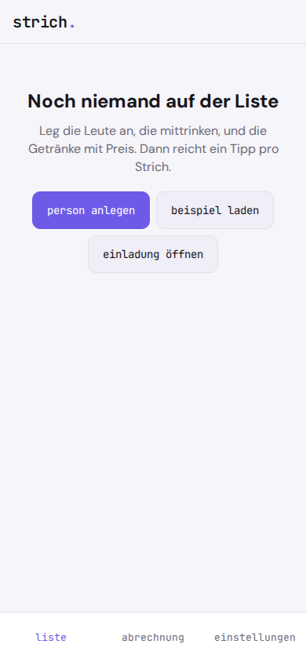
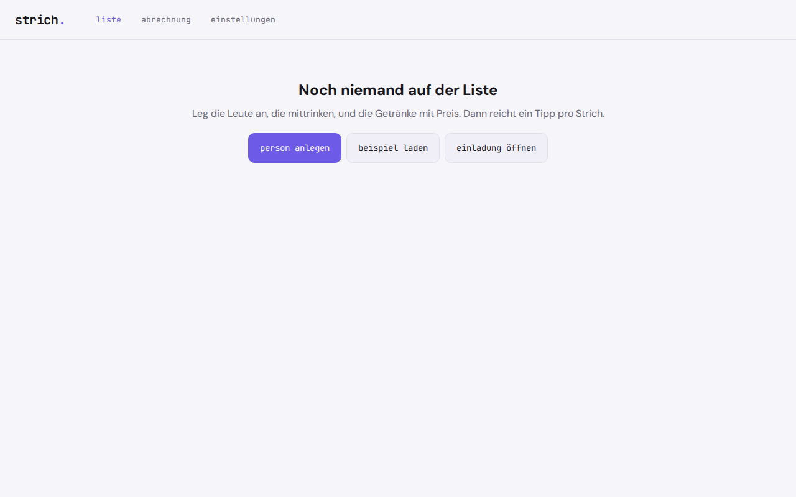

# strich.

**Striche setzen, am Monatsende fair abrechnen.** strich. ist die Getränke-Strichliste für WG, Verein und Büro.

Die Papierliste am Kühlschrank wird unleserlich, geht verloren und muss am Monatsende von Hand zusammengezählt werden. Bezahlte Apps wollen ein Abo, ein Konto oder Internet, offene Lösungen einen eigenen Server. strich. läuft auf einem alten Tablet oder Handy am Kühlschrank: Person antippen, Getränk antippen, fertig. Die Summen rechnet die App.

Reine Rechnung in ganzen Cent, keine KI, kein Server. Alles bleibt auf deinem Gerät.

<p align="center">
  
</p>
<p align="center">
  
</p>

## Warum

Es gibt Strichlisten-Apps, die zählen und abrechnen können, zum Beispiel Strichliste: Getränke Zähler, Getränkewart 2.0 oder bierliste.at. Sie kosten Geld, setzen teils ein Konto und Internet voraus, und keine ist zugleich offen, offline und ohne Konto. strich. ist genau das: ein Werkzeug, ein Job.

## Funktionen

- **Personen** anlegen, umbenennen und archivieren. Archivierte Personen tauchen beim Strichesetzen nicht mehr auf, bleiben aber in der Abrechnung, wenn sie noch offene Striche haben
- **Getränke** mit Name und Preis in Euro, der Preis ist jederzeit änderbar, die Reihenfolge einstellbar
- **Preisvorschlag aus der Kiste**: Kistenpreis und Flaschenzahl eingeben, strich. rundet den Preis pro Flasche auf 5 oder 10 Cent auf und zeigt den ungerundeten Wert dazu
- **Strich setzen**: Person antippen, Getränk antippen. Danach zehn Sekunden lang "rückgängig"
- **Verlauf pro Person** mit Storno für einzelne Striche
- **Abrechnung** für alle offenen Striche oder einen gewählten Zeitraum: Summe pro Person und gesamt, aufklappbar nach Getränk
- **Abschließen**: die offenen Striche gehören danach diesem Abschluss, pro Person lässt sich "bezahlt" abhaken
- **Export** der Abrechnung als CSV für deutsches Excel (Semikolon, Dezimalkomma)
- **Mehrere Handys am selben Abend**: Einladungslink teilen, die anderen öffnen ihn und haben dieselben Personen, Getränke und offenen Striche. Jedes Handy setzt seine eigenen Striche, vor dem Abrechnen schicken alle ihren Link zurück. strich. führt ohne Doppelte zusammen, Stornos wandern mit
- **Sicherung** aller Daten als JSON-Datei, Import auf einem anderen Gerät mit Vorschau vor dem Ersetzen
- **Beispieldaten** (erfundene Personen und Getränke, als `beispiel` markiert) mit einem Klick wieder entfernbar, nach Rückfrage. Deine eigenen Striche bleiben dabei erhalten, auch wenn sie auf einem Beispielgetränk oder einer Beispielperson liegen
- Hell und dunkel, funktioniert offline, installierbar als App

## Datenschutz

Nichts verlässt dein Gerät. strich. hat keinen Server, kein Konto, keine Analyse, keine Werbung und lädt nichts aus dem Netz nach. Personen, Getränke und Striche liegen nur in der lokalen Datenbank deines Browsers (IndexedDB). Exporte und Sicherungen entstehen nur, wenn du sie selbst auslöst.

Der Einladungslink trägt den offenen Stand selbst, gepackt hinter dem `#` der Adresse. Dieser Teil geht beim Öffnen nicht an den Server, auf dem strich. liegt. Den Link verschickst du aber selbst, etwa über einen Messenger, und wer ihn hat, sieht Namen und Striche. Schick ihn deshalb nur an die Runde.

Weil die Daten nur im Browser liegen: Wer die Websitedaten löscht oder das Gerät verliert, verliert auch die Liste. Mach deshalb ab und zu eine Sicherung. strich. fragt beim Browser nach dauerhaftem Speicher und zeigt dir das Datum der letzten Sicherung.

Grenzen, bewusst wie bei der Papierliste:

- Jeder am Gerät kann bei jedem Striche setzen. Es gibt keine PIN und keine Rechte pro Person
- Kein Live-Abgleich: Die Handys gleichen sich nur ab, wenn jemand einen Link öffnet. Ein Server, der alles ständig verteilt, widerspräche dem Grundsatz, dass alles auf dem Gerät bleibt
- Kein eigenes Konto pro Person, der Link ist kein Zugang mit Rechten
- Abrechnen geht auf einem Handy. Die anderen zeigen danach weiter ihre alten offenen Summen an, ein abgeschlossener Stand wandert nicht mit
- Ist strich. auf dem iPhone als App installiert, öffnet ein angetippter Link den Browser und nicht die App. Dann den Link kopieren und in der App unter "mehrere handys" einfügen
- Für den Umzug auf ein neues Gerät gibt es Export und Import
- Keine Bestandsverwaltung, keine Online-Bezahlung, keine Bankanbindung

## Installation

strich. ist eine statische Web-App. Es gibt keinen Build-Schritt und keine Abhängigkeiten.

1. Den Ordner `strich/` auf einen beliebigen statischen Host legen (eigener Webspace, GitHub Pages, Netlify, ein Raspberry Pi). Für die Installation als App ist HTTPS nötig.
2. Die Adresse im Browser des Tablets oder Handys öffnen.
3. Im Browsermenü **Zum Startbildschirm hinzufügen** wählen. Danach startet strich. wie eine App und funktioniert auch ohne Netz.

Lokal testen:

```
cd strich
python3 -m http.server 8000
```

Dann `http://localhost:8000` im Browser öffnen.

## Wie gerechnet wird

**1. Striche in Cent.** Jeder Strich speichert den Preis, der beim Setzen galt. Eine spätere Preisänderung verändert alte Striche nicht. Alle Beträge sind ganze Cent, es gibt keine Schätzung und damit auch keine Spanne.

**2. Summe pro Person.** Summe der Preise aller nicht stornierten Striche. Stornierte zählen nicht.
Beispiel: 3 × Wasser zu 80 ct und 2 × Bier zu 120 ct ergeben 240 + 240 = 480 ct = 4,80 €.

**3. Preisänderung und Storno.** Zwei Bier zu 120 ct, dann Preis auf 150 ct, danach zwei Bier zu 150 ct, davon eins storniert: 2 × 120 + 1 × 150 = 390 ct = 3,90 €. Zusammen mit dem Beispiel oben: 870 ct = 8,70 €.

**4. Abrechnung.** Pro Person und Getränk Anzahl und Summe, dazu die Gesamtsumme. Beim Abschließen werden nur offene, nicht stornierte Striche im gewählten Zeitraum dem Abschluss zugeordnet.

**5. Preisvorschlag.** Preis pro Flasche = Kistenpreis ÷ Anzahl, aufgerundet auf 5 oder 10 Cent, damit die Kasse nicht ins Minus läuft. Das ist der einzige gerundete Wert, und die App zeigt den ungerundeten dazu.
Beispiel: Kiste 18,99 €, 20 Flaschen: 94,95 ct pro Flasche, auf 5 ct gerundet 95 ct, auf 10 ct gerundet 100 ct.

**6. Mehrere Handys.** Jeder Strich hat eine zufällige Kennung. Beim Zusammenführen kommen nur Striche, Personen und Getränke dazu, deren Kennung das Handy noch nicht kennt. Ein Storno wandert mit, solange der Strich noch offen ist, und wird nie zurückgenommen. Bekannte Personen und Getränke behalten ihren Stand auf dem Handy. Denselben Link zweimal zu öffnen ändert nichts.
Beispiel: Handy 1 hat Anna 1 Bier (120 ct) und lädt Handy 2 ein. Danach setzt Handy 2 für Ben 2 Wasser und für Anna 1 Wasser (je 80 ct), Handy 1 für Ben 1 Bier. Handy 2 schickt seinen Link zurück: Anna 120 + 80 = 200 ct, Ben 120 + 160 = 280 ct, gesamt 480 ct. Storniert Handy 2 danach ein Wasser von Ben und schickt erneut, sind es 400 ct, und nach dem Link von Handy 1 zeigt auch Handy 2 400 ct.

Die Rechenfunktionen liegen als reine Funktionen in `src/rechnen.js` und `src/abgleich.js` und sind mit `node test-calc.js` gegen diese Handrechnungen getestet.

## Lizenz

GNU Affero General Public License v3.0 (AGPL-3.0), siehe `LICENSE`.

---

**gedacht.gemacht.** Kleine, ehrliche Software. Alles bleibt auf deinem Gerät.
